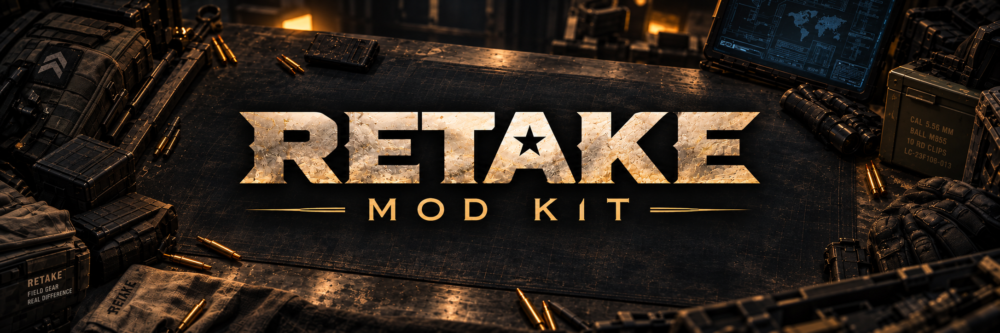

# Retake Mod Kit

Create maps and weapons for **Retake** in a standalone Unreal project.

> **Development preview:** setup and authoring are available. Public compatibility qualification is still in progress, so normal export and game testing remain gated. This is not a finished kit release. **UE5.8 is not supported yet.**

## 1. Get the kit

Install Git, Python **3.11+**, and the Visual Studio C++ tools required by the engine.

```powershell
git clone https://github.com/humarkx/RetakeModKit.git
cd RetakeModKit
```

All current assets are included directly in Git; **Git LFS is not required**. If you received the kit ZIP, extract it and continue below.

## 2. Set up Unreal

Obtain Unreal Engine source through your Epic-linked GitHub account. Check out the **exact UE6 revision** in [Engine.json](ModKit/Engine.json), then follow Epic's source-build instructions to build **UnrealEditor** and **ShaderCompileWorker** for Windows. A different UE6 checkout or Launcher engine will not pass setup.

From the kit folder, run these commands with your engine's location:

```powershell
.\Setup.ps1 -EngineRoot 'D:\YourEngine'
.\Open-ModKit.ps1
```

Setup builds the kit plugins and authoring tools. You use existing Retake client/server packages for gameplay; you do not build Retake.

## 3. Create your mod

| Start with | Guide |
|---|---|
| An empty map, a basic starting area, or a separate map example | [Create a map](Docs/Maps.md) |
| An empty weapon pack or the original example carbine | [Create weapons](Docs/Weapons.md) |

Create a new mod namespace before editing examples. Keep your assets inside that mod and track it in its own repository; the kit ignores `Mods/*`.

## 4. Prepare, export and test

**Create → Author → Validate → Prepare/Bake → Export → Test**

Follow the [export and testing guide](Docs/Export.md) once a qualified kit/game combination is available. Exports contain Windows and Linux server content; editable-source recovery is a separate archive. Uploading and workshop integration are outside this kit.

[Compatibility & troubleshooting](Docs/Compatibility.md) · [License](LICENSE.txt) · [Third-party notices](Notices/ThirdParty.md)
